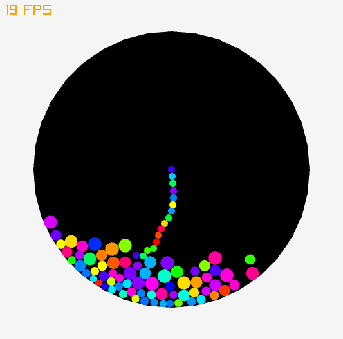

# Yet_Another_Physics_Engine (YAP)

A physics engine I made myself. Written in Rust.
for Terra week #5 & #6!

[*!LATEST RELEASE!*](https://github.com/Alex-SJuice/Yet_Another_Physics_Engine/releases/tag/v0.0.2) 

## Motivation
I love physics. I love simulations. But everytime I try to make my own physics simulation, it doesn't turn out very well. It's always some half-baked circle simulator that is barely stable.
So I've decided that I'm going to spend the time to make this correctly. No more "wing it" or "I can just make another" mentality, I'm going to make a real physics engine, similar to Box 2D.
This will be a very big learning experience for me, especially in terms of optimization and vector math.

## Features

ship #1
 - basic ball simulator
 - basically all of the rendering backbone needed to expand the simulation

## How to Use
### Windows
- Download the executable and run it
- Click to add more balls
### Linux & Mac
- Install Rust
- Download the source code
- build it with 'cargo run' or 'cargo run --release' for better performance